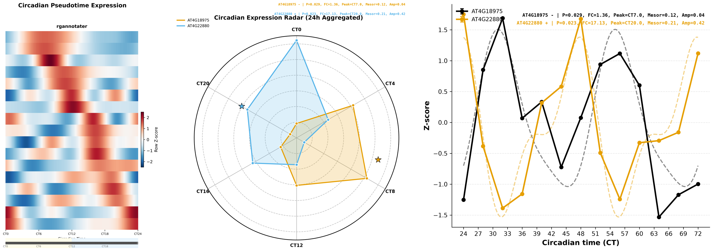
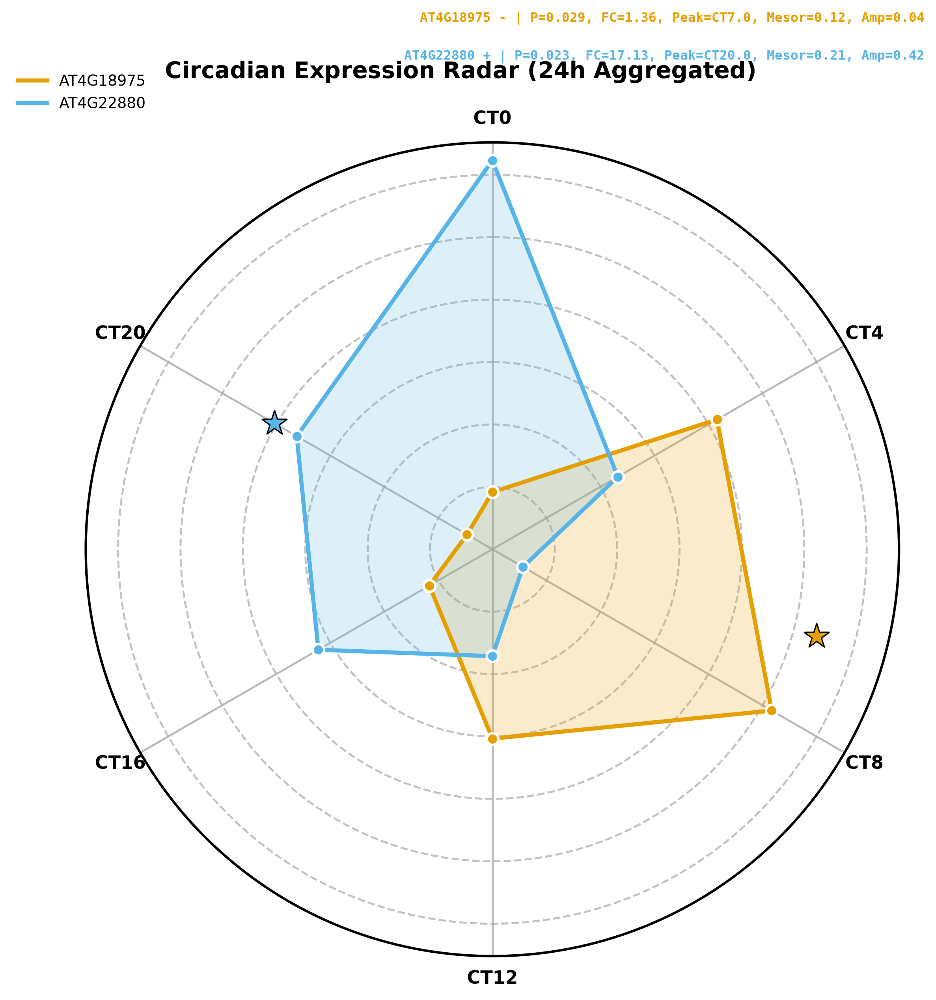
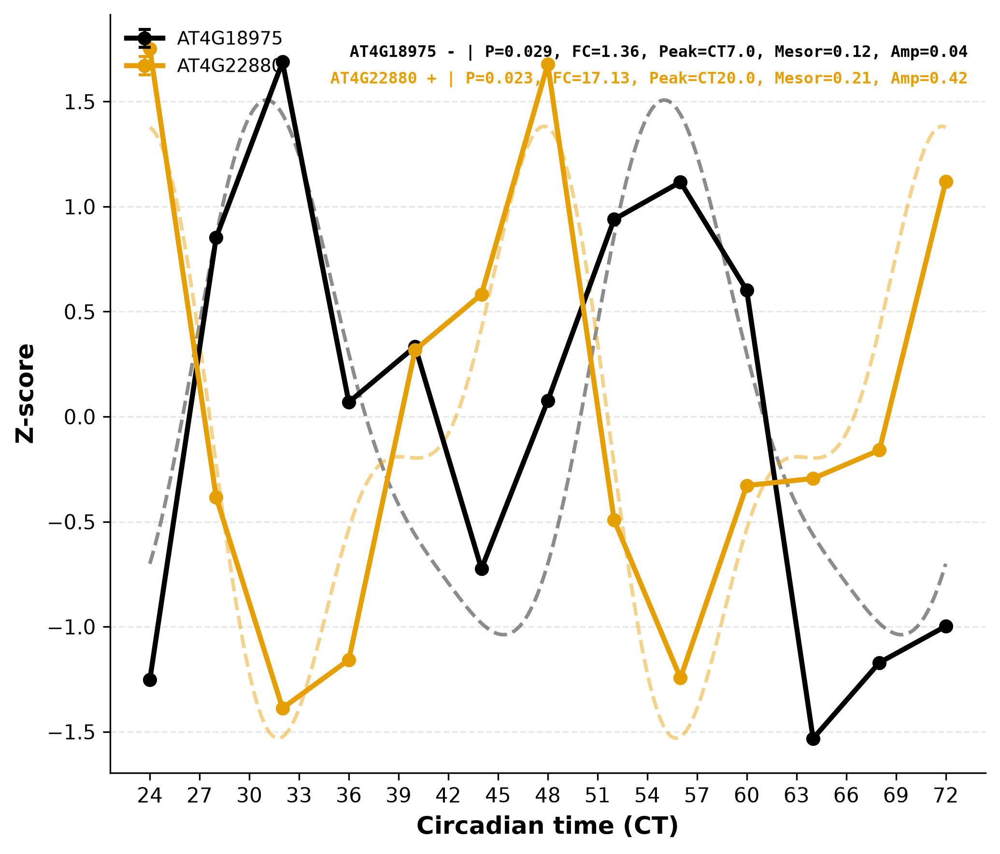

# RGAnnotator

**RGAnnotator** (Rhythm Gene Annotator) is an integrated Python toolkit for studying plant circadian clock genes. It bundles three modules into a single command-line tool:

| Module | Command | Function |
|---|---|---|
| 1. Identification | `rgannotator identify` | Identify circadian clock gene homologs in any plant genome proteome via reciprocal BLASTP against a curated panel of 49 *Arabidopsis* clock genes |
| 2. Rhythm analysis | `rgannotator rhythm` | Detect rhythmic expression and estimate phase/amplitude with **JTK_CYCLE** (default, non-parametric) or **Cosinor** (harmonic regression) |
| 3. Visualization | `rgannotator pseudotime` / `radar` / `line` | Publication-ready circadian pseudotime plots, 24 h radar plots and time-course line plots |



## Contents
- [Installation](#installation)
- [Quick start](#quick-start)
- [Module 1: Clock gene identification](#module-1-clock-gene-identification)
- [Module 2: Rhythm analysis](#module-2-rhythm-analysis)
- [Module 3: Visualization](#module-3-visualization)
- [Input data format](#input-data-format)
- [Output columns](#output-columns)
- [Citation & license](#citation--license)

## Installation

### Requirements
- Python >= 3.8
- Python packages: `pandas`, `numpy`, `scipy`, `statsmodels`, `matplotlib`, `biopython` (module 1 only)
- [NCBI BLAST+](https://blast.ncbi.nlm.nih.gov/doc/blast-help/downloadblastdata.html) (`makeblastdb`, `blastp`) on PATH — module 1 only

```bash
# clone
git clone https://github.com/<user>/RGAnnotator.git
cd RGAnnotator

# install python dependencies
pip install -r requirements.txt
# or: conda install -c conda-forge pandas numpy scipy statsmodels matplotlib
#     conda install -c bioconda blast biopython

# optional: install as a package (provides the `rgannotator` command)
pip install .
```

No installation is strictly required — every module runs directly from the repository:

```bash
python -m rgannotator --help          # unified CLI
python -m rgannotator.rhythm --help  # any single module, standalone
```

## Quick start

```bash
# Module 1: identify clock genes in a proteome (or a directory of proteomes)
python -m rgannotator identify -i Medicago.pep.fa -o clockfinder_results

# Module 2: detect rhythmic genes (JTK_CYCLE by default)
python -m rgannotator rhythm -i expression.csv -o rhythm_jtk.csv

# Module 2, alternative engine: Cosinor fit
python -m rgannotator rhythm -i expression.csv -o rhythm_cosinor.csv -m cosinor

# Module 3: figures
python -m rgannotator pseudotime -i expression.csv -o pseudotime.png
python -m rgannotator radar   -i expression.csv -o radar.svg -g CCA1,LHY,TOC1
python -m rgannotator line    -i expression.csv -o line.svg -g CCA1,LHY
```

## Module 1: Clock gene identification

`identify` finds circadian clock homologs in a target proteome with a reciprocal-best-hit BLASTP workflow:

1. `makeblastdb` on the target proteome
2. **Forward BLASTP**: curated clock panel (`data/circadian.fa`, 49 *Arabidopsis* clock genes covering TTFL core, photoreceptors, photomorphogenesis and clock output regulators) → target proteome, collecting candidates at E ≤ 1e-10
3. **Reverse BLASTP**: candidates → full TAIR10 proteome database (bundled, `data/TAIR10_DB_new.tar.gz`, auto-extracted on first use)
4. Keep candidates whose best TAIR10 hit is itself a clock gene (specificity filter)
5. Rename hits `<prefix><ClockName>-<rank>` (e.g. `MsCCA1-1`) and write per-species CSV + renamed FASTA, plus an all-species summary

```bash
python -m rgannotator identify -i pep_dir/ -o clockfinder_results -t 16
# single file works too:
python -m rgannotator identify -i Medicago.truncatula.pep.fa
```

Options: `-t` threads, `-e` E-value (default 1e-10), `--circadian_fa` custom clock panel, `--tair_db` custom reverse database (e.g. rebuild with `makeblastdb -in TAIR10_pep -dbtype prot -out TAIR10_DB_new`).

Output per species (`<species>_clockfinder.csv`):

| Species | Mc_Gene | Matched_Ath_ID | Clock_Name | New_Name | Evalue | Bitscore |
|---|---|---|---|---|---|---|
| Medicago | MtrunA9... | AT2G46830.1 | CCA1 | MtCCA1-1 | 0 | 812 |

## Module 2: Rhythm analysis

`rhythm` tests every gene for ~24 h rhythmicity and returns phase and effect sizes. Two engines share one interface; results from both are directly comparable:

| | `-m jtk` (default) | `-m cosinor` |
|---|---|---|
| Model | non-parametric Kendall rank correlation vs. 24-phase cosine grid | least-squares single-cosine fit (24 h period) |
| Test | Kendall τ with Bonferroni correction across phases | OLS F-test on the first harmonic |
| Input values | **all individual replicates** | per-time-point means |
| Robust to outliers/non-normal noise | yes | less |
| Peak time resolution | 1 h grid | continuous |

Both engines report peak time (CT, 0–24 h), mesor, amplitude and fold change, then apply BH-FDR across genes. A gene is called **rhythmic** when `Adj_P_value < 0.05` **and** `Fold_Change >= threshold` (default 1.5, change with `-fc`).

```bash
# CT-labelled columns are auto-detected; force manual layout with -ZT
python -m rgannotator rhythm -i expression.csv -o result.csv -m jtk -fc 1.5 -t 8
python -m rgannotator rhythm -i expression.csv -o result.csv -ZT -zt0 0 -int 4 -r 3
```

## Module 3: Visualization

All plots share the same expression-CSV input and time-parsing rules as module 2, and annotate every profile with the JTK test (P, fold change, peak CT, rhythmic `+`/`-` tag).

### `pseudotime` — circadian pseudotime plot (CT as pseudotime)

Profiles are folded onto one 0–24 h day, cubic-interpolated, Gaussian-smoothed and row Z-scored; genes are ordered by peak phase (`-order peak`) or hierarchical clustering (`-order cluster`). Optional: duplicate the cycle for wrap-around display (`-nc 2`), mark genes of interest on the left (`-g`), attach a category annotation strip (`-anno`), or filter rows (`-gl`).

```bash
python -m rgannotator pseudotime -i expression.csv -o pseudotime.png -nc 2 -order peak -g MsLHY -anno gene_categories.csv
```


### `radar` — 24 h radar (polar) plot

All time points wrap modulo 24 h onto one clock face; replicates are averaged. Axis labels follow the actual sampling grid. With `-z` (Z-scores) profiles are shifted so several genes can be compared on one face; the fitted peak is marked with a star.

```bash
python -m rgannotator radar -i expression.csv -o radar.svg -g CCA1,LHY,TOC1,PRR7 -z -fc 1.5
```



### `line` — time-course line plot

Mean ± SD per time point with a fitted two-harmonic (24 h + 12 h) curve; shows the full multi-day time course (e.g. CT24–CT72). Multiple files overlay with file-colored series.

```bash
python -m rgannotator line -i expression.csv -o line.svg -g CCA1,LHY,TOC1 -z -all
```



## Input data format

Expression CSV: first column = gene ID, remaining columns = expression values (TPM/FPKM/relative expression; any monotone scale).

Two time layouts:

**CT mode (auto-detected)** — headers encode circadian time directly; `_n` suffixes denote replicates. Multi-day labels (e.g. `CT28`) wrap automatically where the plot needs one day (radar/pseudotime) and are kept absolute for statistics and line plots:

```csv
Gene,CT0,CT4,CT8,CT12,CT16,CT20,CT24,CT28,CT32
CCA1,1.2,3.4,5.1,2.0,0.6,0.9,1.3,3.8,5.0
LHY,1.1,3.1,4.8,1.9,0.7,0.8,1.2,3.5,4.9
```

**Manual mode (`-ZT`)** — headers carry no time info; describe the design with `-zt0` (first ZT), `-int` (hours between points), `-r` (replicates per point; consecutive columns belong to the same point):

```csv
Gene,ZT0_1,ZT0_2,ZT4_1,ZT4_2,ZT8_1,ZT8_2
CCA1,1.2,1.3,3.4,3.6,5.1,4.9
```

## Output columns

`rhythm` result table:

| Column | Meaning |
|---|---|
| `Gene_ID` | gene identifier |
| `P_value` | engine p-value (JTK: phase-Bonferroni-corrected Kendall; Cosinor: OLS F-test) |
| `Adj_P_value` | BH-FDR across all genes |
| `Peak_Time` | estimated peak phase, CT 0–24 (JTK: 1 h grid; Cosinor: continuous) |
| `Mesor` | midline of the rhythm (JTK: global mean; Cosinor: fitted mesor) |
| `Amplitude` | JTK: max-min of time-point means; Cosinor: fitted half-amplitude |
| `Fold_Change` | max/min time-point mean |
| `Rhythmic` | `Adj_P_value < 0.05` AND `Fold_Change >= -fc` threshold |

`identify` output columns are documented in [Module 1](#module-1-clock-gene-identification).

## Repository structure

```
RGAnnotator/
├── rgannotator/          # Python package
│   ├── cli.py            # unified command-line interface
│   ├── identify.py       # module 1: reciprocal BLAST identification
│   ├── rhythm.py         # module 2: JTK_CYCLE + Cosinor engines
│   ├── pseudotime.py     # module 3: circadian pseudotime plot
│   ├── radar.py          # module 3: 24 h radar plot
│   ├── lineplot.py       # module 3: time-course line plot
│   ├── timeparse.py      # shared CT/manual time parsing
│   └── plotlib.py        # shared plotting helpers
├── data/
│   ├── circadian.fa      # curated 49-gene Arabidopsis clock panel
│   └── TAIR10_DB_new.tar.gz  # bundled TAIR10 BLASTP database
├── example/
│   ├── rgannotater.csv   # example expression matrix (Arabidopsis, CT24-72)
│   └── output/           # results and figures produced by the commands above
├── requirements.txt
└── pyproject.toml
```

## Citation & license

If RGAnnotator helps your research, please cite: *to be added upon publication*.

Released under the MIT License — see [LICENSE](LICENSE).
